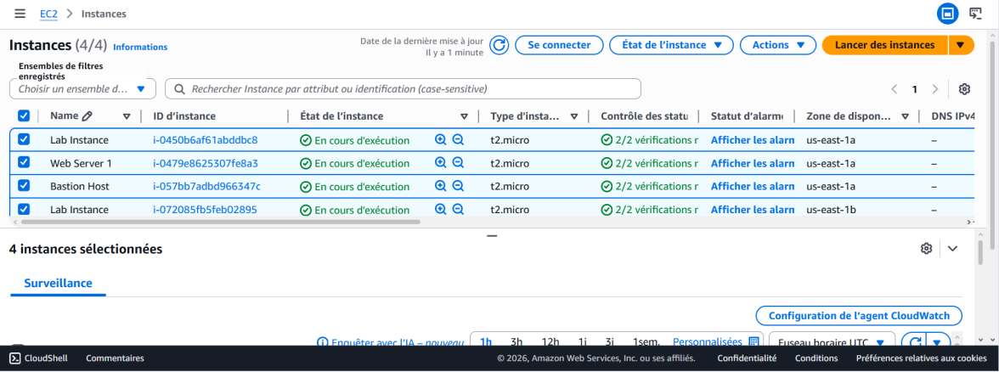
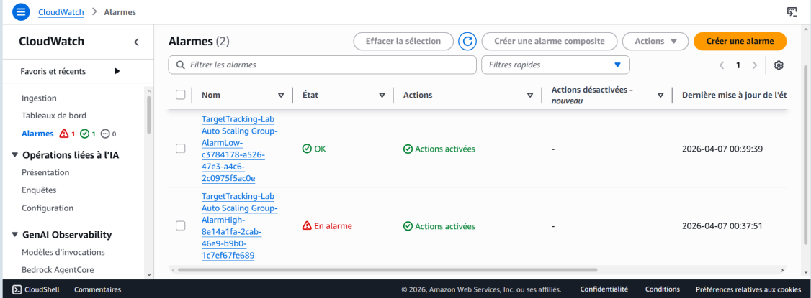

# AWS Cloud Architecture Labs — From a Single EC2 Server to a Scalable, Highly Available Architecture

A progressive series of AWS labs (AWS Academy Cloud Foundations): launching and operating EC2, block storage with EBS, PaaS deployment with Elastic Beanstalk, a Multi-AZ relational database with RDS, and finally an **elastic, fault-tolerant web tier** with an Application Load Balancer and Auto Scaling.

> Academic labs — Cloud Computing module, ENSA Fez (GSCSI), 2026.

  

---

## Final architecture

```
                         Internet
                            │
              ┌─────────────▼─────────────┐
              │ Application Load Balancer │   public subnets (2 AZs)
              └─────────────┬─────────────┘
          ┌─────────────────┴─────────────────┐
   ┌──────▼──────┐                     ┌──────▼──────┐
   │ EC2 (AZ a)  │   Auto Scaling      │ EC2 (AZ b)  │   private subnets
   │ WebServerAMI│   group: min 2,     │ WebServerAMI│   target tracking
   └──────┬──────┘   max 6             └──────┬──────┘   CPU = 60 %
          └─────────────────┬─────────────────┘
              ┌─────────────▼─────────────┐
              │ Amazon RDS MySQL Multi-AZ │   primary + synchronous standby
              └───────────────────────────┘
```

## The labs

| Lab | Topic | What I did |
|---|---|---|
| 1 | **Amazon EC2 & Lambda** | Launched an Amazon Linux 2023 web server with a **User Data** script (Apache install + custom page), enabled termination/stop protection, monitored it with status checks and CloudWatch, opened HTTP in the security group, **resized** the instance (t2.micro → t2.small) and **extended the EBS root volume** (8 → 10 GiB). Automated instance shutdown with an **AWS Lambda** function (Python, boto3) triggered on a schedule by **EventBridge**. |
| 2 | **Elastic Beanstalk & EBS** | Deployed a Java (Tomcat) application on **Elastic Beanstalk** and analysed the resources it provisions (EC2, load balancer, Auto Scaling). Created a 1 GiB **EBS volume**, attached it, formatted and mounted it with persistence in `/etc/fstab`, then created and restored an **EBS snapshot**. |
| 3 | **Amazon RDS (Multi-AZ)** | Built a **DB security group** allowing MySQL (TCP 3306) **only from the web tier's security group** (least privilege), a **DB subnet group** across two AZs (us-east-1a / us-east-1b), and a **Multi-AZ MySQL** instance (db.t3.micro, 20 GB). Connected a web application on EC2 and validated reads and writes. |
| 4 | **ELB & Auto Scaling** | Created a **custom AMI** from the configured web server, an **Application Load Balancer** with a target group and health checks, a **launch template** and an **Auto Scaling group** (desired/min 2, max 6) in private subnets across 2 AZs, with a **target tracking policy at 60 % CPU**. Ran a load test: CloudWatch alarm fired and **new instances were launched automatically**, then the original server was terminated. |

## Results

**Scale-out under load** — Auto Scaling launched new instances when CPU exceeded the 60 % target:



**CloudWatch alarms** driving the scaling policy:



## Key design choices

- **High availability:** every tier spans two Availability Zones (ALB, EC2 instances, RDS primary + standby).
- **Security:** web servers in private subnets, only the load balancer is exposed; database reachable only from the web tier's security group.
- **Elasticity & cost:** capacity follows real load (min 2 for availability, max 6 to cap costs).
- **Immutability:** every new instance is a clone of the same AMI — no manual configuration drift.

## Skills demonstrated

AWS · EC2 · EBS · Elastic Beanstalk · RDS Multi-AZ · VPC & subnets · Security Groups · Application Load Balancer · Auto Scaling · CloudWatch · Lambda (boto3) · EventBridge · high availability · least privilege

## Documentation (French)

- [Lab 1 — EC2 & Lambda](docs/lab1-ec2-lambda.pdf)
- [Lab 2 — Elastic Beanstalk & EBS](docs/lab2-elastic-beanstalk-ebs.pdf)
- [Lab 3 — RDS Multi-AZ](docs/lab3-rds-multi-az.pdf)
- [Lab 4 — Load Balancing & Auto Scaling](docs/lab4-elb-auto-scaling.pdf)

---

**Author:** Khaoula Belhaj — final-year engineering student, Communicating Systems & Computer Security, ENSA Fez · [LinkedIn](https://linkedin.com/in/khaoula-belhaj-1999163a6)
